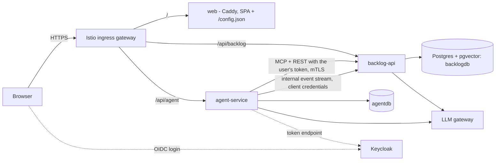

# Kubernetes deployment (Kustomize + Istio)

```text
deploy/k8s/
  base/                 Namespace, ServiceAccounts, Deployments/Services/PDBs for web, backlog-api, agent-service,
                        HPA for backlog-api, ConfigMaps (configMapGenerator). No Secrets.
  istio/                Gateway, VirtualService, DestinationRules, PeerAuthentication (STRICT), RequestAuthentication,
                        AuthorizationPolicies
  overlays/dev/         one replica per service, placeholder Secrets, auth.mode=oidc
  overlays/platform/    auth.mode=platform + the ext-authz login policy for the ingress gateway (oauth2-proxy)
  examples/             optional CloudNativePG cluster with pgvector
```

```bash
kubectl kustomize deploy/k8s/overlays/dev | kubectl apply -f -          # or: kubectl apply -k deploy/k8s/overlays/dev
```

The `.example.com` / `.example.test` hostnames and `ghcr.io/example/*` images are **placeholders**: copy an overlay and
set your own. Nothing in this directory contains a real secret.

## Topology



Browser traffic enters through the gateway only; the routes in `istio/virtual-service.yaml` send `/api/backlog` and
`/api/agent` straight to the services (the Caddy proxy inside `web` is only used by Docker Compose and for direct
access). The sidecar mesh is on for the namespace (`istio-injection: enabled`), mTLS is STRICT.

## Prerequisites

- Kubernetes 1.28+, Istio 1.22+ (sidecar mode) with an ingress gateway (`istio=ingressgateway`, `istio-system`), a TLS
  certificate Secret `backlog-tls` in `istio-system` (cert-manager), a metrics-server for the HPA.
- **Postgres is an external dependency.** Use a managed PostgreSQL 16+ with the `vector` and `citext` extensions, two
  databases (`backlogdb`, `agentdb`) and one owner role per database. `examples/postgres-cloudnativepg.yaml` shows an
  in-cluster option. The services run their Alembic migrations on start (`*_AUTO_MIGRATE=true`, guarded by an advisory
  lock, safe with several replicas); set it to `false` and run migrations as a Job if the role may not create extensions.
- **Keycloak** (separate namespace/cluster) with the `backlog` realm, see below.
- An OpenAI-compatible LLM gateway (`*_LLM_BASE_URL`).

## Secrets to create

The Deployments reference two Secrets by name. The dev overlay generates **placeholder** values so that the manifests
render; for anything real, create them out of band (kubectl, External Secrets, Sealed Secrets, ...) and remove the
`secretGenerator` from your overlay.

| Secret | Keys |
|---|---|
| `backlog-api-secrets` | `BACKLOG_DATABASE_URL` (`postgresql://backlog:<pw>@<host>:5432/backlogdb?sslmode=require`), `BACKLOG_EVENTS_TICKET_SECRET` (random, identical on all replicas), `BACKLOG_LLM_API_KEY` |
| `agent-service-secrets` | `AGENT_DATABASE_URL`, `AGENT_SERVICE_CLIENT_SECRET` (the Keycloak `agent-service` client secret), `AGENT_LLM_API_KEY` |

```bash
kubectl -n backlog create secret generic backlog-api-secrets \
  --from-literal=BACKLOG_DATABASE_URL='postgresql://...' \
  --from-literal=BACKLOG_EVENTS_TICKET_SECRET="$(openssl rand -base64 32)" \
  --from-literal=BACKLOG_LLM_API_KEY='...'
```

Non-secret settings live in the ConfigMaps generated in `base/kustomization.yaml` (issuer, JWKS/token URLs, LLM URL and
models, embedding dimension). A change renames the ConfigMap (hash suffix) and rolls the pods. The production images run
with `*_ENV=production`: dev shortcuts (`X-Dev-User-Email`, static internal token) are refused.

## Keycloak client configuration

Do **not** import `deploy/keycloak/realms/backlog-realm.json` as is: it contains the dev users, the dev-only
`backlog-dev-cli` password client and a published dev secret. Create the realm from it, then:

- Remove `backlog-dev-cli` and the test users; require verified, unique emails (`verifyEmail`, SMTP, `duplicateEmailsAllowed=false`): the services reject tokens without `email_verified=true`.
- `backlog-web`: public client, Authorization Code + PKCE S256, redirect URI `https://<host>/*`, web origin `https://<host>`. (auth.mode `oidc` only.)
- Audience mappers on the SPA client (or a shared client scope) so one access token carries `aud` = `backlog-api` **and** `agent-service`.
- `agent-service`: confidential, service account enabled, **new secret** (-> `AGENT_SERVICE_CLIENT_SECRET`), audience mapper `backlog-api`. Its client-credentials token is what backlog-api accepts on `/api/backlog/internal/*` (`BACKLOG_INTERNAL_CLIENT_IDS=agent-service`).
- **Issuer:** the `iss` claim must equal `BACKLOG_OIDC_ISSUER` / `AGENT_OIDC_ISSUER`, the `RequestAuthentication` `issuer` and `OIDC_AUTHORITY` (web-config). Pin the Keycloak hostname (`KC_HOSTNAME`) to the public URL. If pods should fetch keys through an in-cluster address, set `*_OIDC_JWKS_URL` and `AGENT_SERVICE_TOKEN_URL` to it (Keycloak needs `KC_HOSTNAME_BACKCHANNEL_DYNAMIC=true` then); this is how the dev overlay is set up.

## Istio resources

| Resource | Purpose |
|---|---|
| `Gateway` + `VirtualService` | TLS, host routing: `/` -> web, `/api/backlog` -> backlog-api, `/api/agent` -> agent-service |
| `PeerAuthentication` STRICT | mTLS everywhere in the namespace |
| `RequestAuthentication` (backlog-api, agent-service) | validates the Keycloak JWT (issuer, JWKS, audience); `forwardOriginalToken: true` so the services still validate and use the user's own token (the agent forwards it to backlog-api/MCP) |
| `AuthorizationPolicy` `*-require-jwt` | DENY any `/api/*` request without a request principal, except `/healthz`, `/readyz` and the project event stream `.../events` (EventSource cannot send headers; it authenticates with a signed `?ticket=` that backlog-api verifies) |
| `AuthorizationPolicy` `backlog-api-deny-internal-except-agent` | `/api/backlog/mcp` and `/api/backlog/internal/*` are only reachable by the `agent-service` service account (mTLS principal `cluster.local/ns/backlog/sa/agent-service`); the ingress gateway and every other workload are denied |
| `AuthorizationPolicy` `agent-service-allow-gateway-only` | only the ingress gateway can call agent-service |
| `DestinationRule` | ISTIO_MUTUAL, 10 min idle timeout for SSE, cookie-based consistent hash for agent-service |

Probes (`/healthz`, `/readyz`) are rewritten by the sidecar to bypass the policies. If your ingress gateway runs in a
namespace/service account other than the defaults, adjust the principal in `authorization-policies.yaml`.
The `agent-service` token for the internal event stream is a client-credentials JWT with audience `backlog-api`; it
passes the `backlog-api` RequestAuthentication like a user token.

## SSE through the mesh

AG-UI runs (`POST /api/agent/agents/{id}`) and project events (`GET /api/backlog/projects/{id}/events`) are
server-sent events. Envoy does not buffer, so streaming works as long as nothing times out:

- Route timeouts: agent route 300 s (> 180 s run timeout), events route unlimited (the service closes after 15 min and the client resumes with `Last-Event-ID`), other backlog-api routes 120 s. **No retries** (`attempts: 0`) so a POST is never replayed.
- `idleTimeout: 600s` in the DestinationRules; the services send keepalives (15 s).
- Anything in front of the gateway (cloud load balancer, WAF, CDN) needs idle timeouts above 300 s and response buffering off. Example: AWS ALB idle timeout 400 s; nginx ingress `proxy-buffering: off`.
- The pods get a long `terminationGracePeriodSeconds` (agent-service 200 s) so runs finish during rollouts.

## Scaling constraints

- **backlog-api** is stateless: events fan out through Postgres `LISTEN/NOTIFY`, background jobs use `SKIP LOCKED`, tickets use a shared secret. Scale with the HPA (2-6, CPU 70 %). Keep `BACKLOG_EVENTS_TICKET_SECRET` identical on all replicas and mind the Postgres connection budget (`db_pool_size` 10 + overflow 10 per replica).
- **agent-service runs one replica.** The Microsoft Agent Framework keeps pending tool-approval (interrupt) state in process memory, so the request that resumes a run must reach the pod that started it, and a pod restart drops open approvals (users see the run as interrupted and re-ask). To scale out, keep the consistent-hash `DestinationRule` (cookie `agent-affinity`; or hash a thread header) and raise `replicas`; sticky routing is best effort, not a guarantee.
- **web** is static and scales freely (2 replicas, PDB `minAvailable: 1`).
- Pod security: non-root (uid 10001), read-only root filesystem (`/tmp` and Caddy's `/config` and `/data` are `emptyDir`), all capabilities dropped, seccomp `RuntimeDefault`, no service account tokens mounted. The namespace enforces the `restricted` Pod Security level.

## Platform mode (`overlays/platform`)

`auth.mode=platform`: the browser never talks to Keycloak and has no token. The ingress gateway authenticates it:

1. Deploy oauth2-proxy (or another OIDC-capable ext-authz service) against the Keycloak realm, emitting `Authorization: Bearer <access token>` to the upstream (`--set-authorization-header`, `--pass-access-token`).
2. Register it as an `envoyExtAuthzHttp` extension provider named `oauth2-proxy` in the Istio mesh config and route `/oauth2/*` to it (details in `overlays/platform/gateway/ext-authz.yaml`).
3. Apply the overlay: it sets `AUTH_MODE=platform` for the SPA (`/config.json`), and adds a `CUSTOM` AuthorizationPolicy at the gateway that sends everything except health and `/oauth2/*` to the provider. The mesh then validates the injected JWT with the same `RequestAuthentication`.

Without a session, `/api/*` calls get 401; the SPA reloads the page once and the gateway redirects to the login.
The overlay deliberately generates no Secrets; create them as described above.

## Validation

```bash
kubectl kustomize deploy/k8s/overlays/dev      > out-dev.yaml
kubectl kustomize deploy/k8s/overlays/platform > out-platform.yaml
docker run --rm -v "$PWD:/m" ghcr.io/yannh/kubeconform:latest -strict -summary -ignore-missing-schemas /m/out-dev.yaml
```

(Istio CRDs have no schema in the default catalogue and are skipped by `-ignore-missing-schemas`; `istioctl analyze` on a
cluster validates them.)
