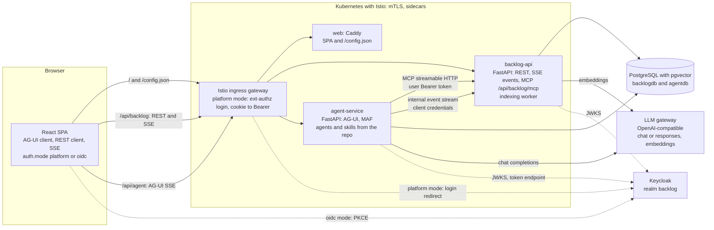
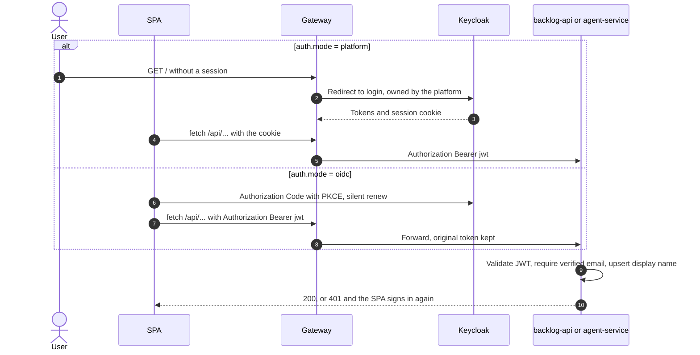
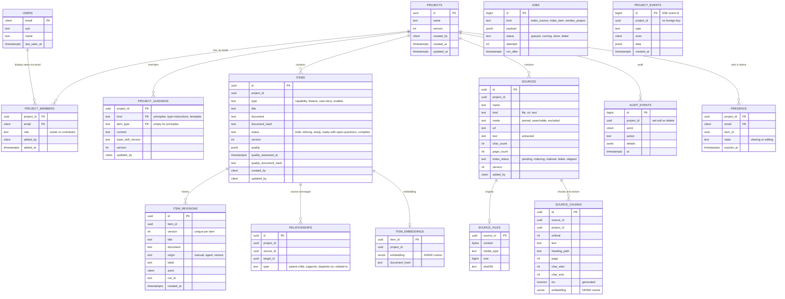
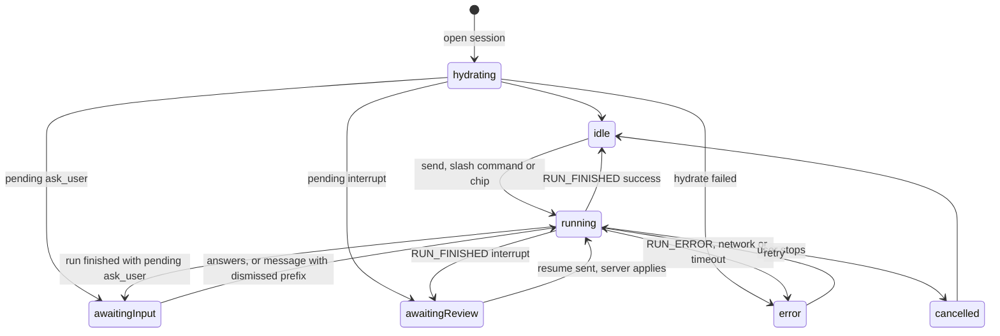
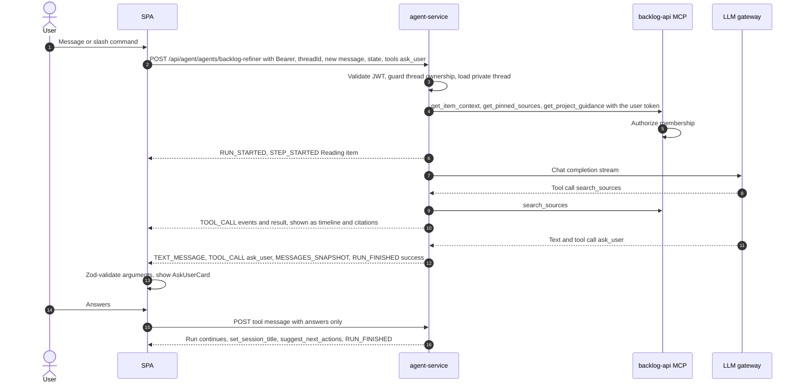
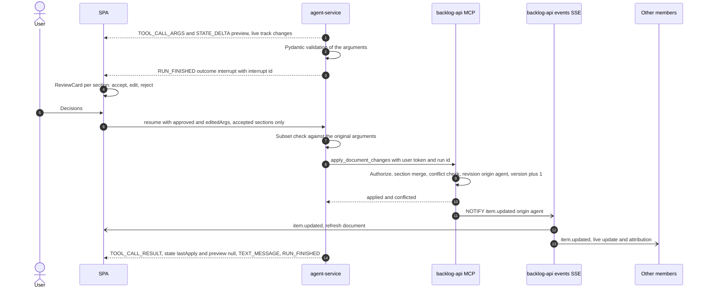
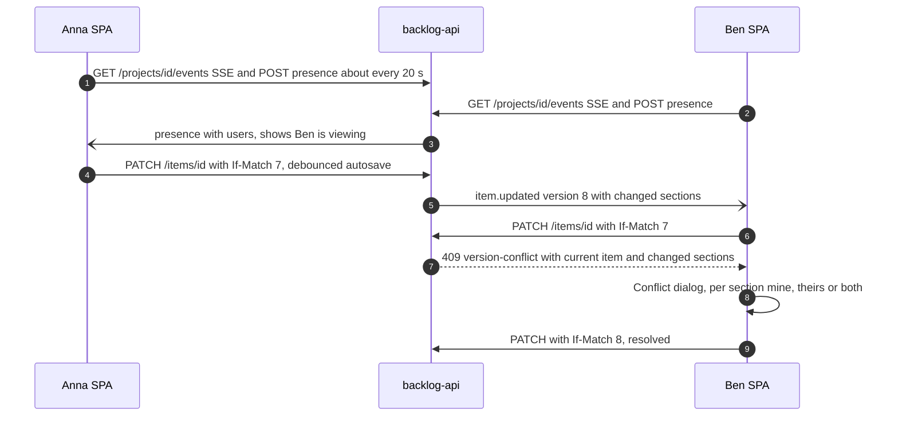
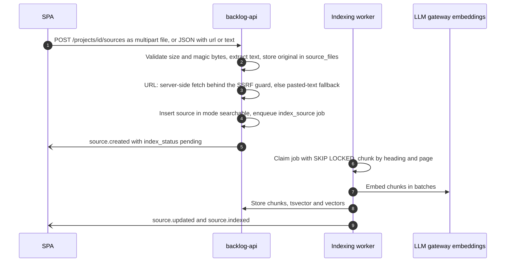

# Architecture

Context document for humans and AI agents. It describes the system **as built**. **Keep it up to date** whenever behaviour, structure, configuration, data formats or features change (see [§17](#17-maintenance-rule) and `AGENTS.md`). Component-level details live next to the code: `services/backlog-api/README.md`, `services/agent-service/README.md`, `contracts/README.md`, `skills/README.md`, `apphost/README.md`, `deploy/k8s/README.md`, `deploy/keycloak/README.md` and `docs/accessibility.md`.

## 1. Purpose

A multi-user, browser-based tool to refine backlog items (Capability, Feature, User Story, Enabler) together with an LLM agent. Each item is one Markdown document based on a placeholder-free template. The agent asks focused follow-up questions (`ask_user`), proposes per-section changes and child items, and assesses quality. The user reviews every proposal with track changes, and **only approved parts are applied**.

Core ideas:

- **The backend is the system of record.** Projects, items, revisions, sources, embeddings, guidance and members live in PostgreSQL behind `backlog-api`. The SPA is online-only and has no IndexedDB data.
- **A generic agent host.** `agent-service` runs agents defined as Markdown files (`services/agent-service/agents/*.agent.md`) on Microsoft Agent Framework (MAF) and speaks AG-UI to the browser. It reaches backlog data only through the **backlog MCP server** with the *user's own token*, so the agent can never exceed the user's rights.
- **Projects are shared.** Owners add people by email; contributors work on items and sources. Refinement conversations stay **private** to their creator; only accepted changes are shared.
- **Guidance is data.** Default principles, per-type instructions and templates are Agent Skills in `skills/`; owners can override them per project.

## 2. Context and containers



| Container | Technology | Responsibility | Does **not** own |
|---|---|---|---|
| `apps/web` (`@backlog/web`) | React 19, TypeScript, Vite, TanStack Query, `@ag-ui/client`, oidc-client-ts, Zod | UI, REST + AG-UI clients, `ask_user` and review UX, client-side preview diff, theme/layout preferences | Persisted backlog data, LLM credentials, merge authority |
| `services/backlog-api` | Python, FastAPI, SQLAlchemy 2 async, asyncpg, Alembic, `mcp` | Users directory, projects, members, items, relationships, revisions, quality, guidance overrides, sources + files, extraction, chunking, embeddings, hybrid search, project events + presence, authoritative document merge, backup, audit log, **backlog MCP server**, indexing worker | Agent execution, conversations |
| `services/agent-service` | Python, FastAPI, MAF (`agent-framework-core` 1.26, `agent-framework-ag-ui` 1.8.1), asyncpg | Agent catalogue, runs, private threads + snapshots, approval flow, tool policy, model calls, AG-UI, feedback | Backlog data (only via MCP with the user's token) |
| PostgreSQL | pgvector image `pgvector/pgvector:pg17`, extensions `vector`, `citext` | `backlogdb` (domain, files, vectors, jobs, events) and `agentdb` (threads) | — |
| Keycloak | Realm `backlog` | Identity and tokens | Per-project authorization (done in backlog-api) |
| LLM gateway | Any OpenAI-compatible endpoint | Model routing and provider credentials (chat + embeddings) | — |
| Istio (cluster only) | `RequestAuthentication`, `AuthorizationPolicy`, mTLS | Defence in depth; the services **always validate the JWT themselves** so Aspire, Compose and the cluster behave identically | — |

The browser never calls an LLM. `/config.json` carries only auth mode/authority/client id/scope, the two API base paths and the agent id; it is never bundled and never secret.

## 3. Repository layout

```text
apps/web/                     React SPA (@backlog/web): src/{app,agent,api,auth,askuser,backlog,chat,collab,config,
                              context,contracts,domain,history,palette,quality,review,run,settings,shell,sources}
services/backlog-api/         Python package backlog_api (FastAPI): api/, db/, auth/, migrations/, scripts/export_openapi.py
services/agent-service/       Python package agent_service: agents/, tools/, mcp_client/, threads/, hooks/, llm/, auth/, db/
  agents/backlog-refiner.agent.md   Agent definition (frontmatter + base instructions)
  tools/tools.yaml                  MCP bindings (backlog; Jira stub commented out)
libs/py-skills/               backlog_skills: parse/validate skills/, default guidance and templates
libs/py-contracts/            backlog_contracts: Pydantic mirrors of contracts/schemas
skills/                       Agent Skills: backlog-refinement (core) + backlog-{capability,feature,user-story,enabler}
contracts/                    schemas/ (JSON Schema), fixtures/ (shared valid/invalid + document goldens), openapi/ (snapshot)
apphost/                      Aspire TypeScript AppHost (apphost.mts, aspire.config.json)
deploy/                       caddy/, keycloak/, k8s/ (Kustomize + Istio), fake-gateway/, postgres/, compose-smoke.sh
e2e/                          Playwright end-to-end tests (@backlog/e2e), run against the Compose stack
docker-compose.yml            Full local stack (web 8088, Keycloak 8080, APIs on 127.0.0.1:8001/8002)
package.json, pnpm-workspace.yaml, pyproject.toml (uv workspace), uv.lock, pnpm-lock.yaml
```

Python is 3.13 locally (`.python-version`; `requires-python >=3.12`). Node ≥ 22.12, pnpm 12. Dependency direction in the SPA: UI modules depend on `api/`, `agent/`, `contracts/` and `domain/`; `domain/` has no I/O.

## 4. Authentication and authorization

### 4.1 Login modes (`/config.json` → `auth.mode`)



- **`oidc`:** the SPA signs in with Authorization Code + PKCE (oidc-client-ts). Tokens and PKCE state live in `sessionStorage` only, never `localStorage`; renewal uses refresh tokens.
- **`platform`:** the platform gateway authenticates the browser and injects the bearer token. The SPA sends no token, reads the user from `GET /api/backlog/me` and performs one full page reload on a 401 (guarded against reload loops).
- Keycloak clients (dev realm `deploy/keycloak/realms/backlog-realm.json`, see `deploy/keycloak/README.md`): `backlog-web` (public, PKCE S256), `backlog-api` and `agent-service` audiences (audience mappers, so **one access token works for both services and for the agent → MCP call**), `agent-service` (confidential, client credentials, used for the internal event stream), and the dev-only password client `backlog-dev-cli`. Test users: `alice`, `bob`, `carol` `@example.test` (verified), `dave@example.test` (unverified), password `dev-password`.

### 4.2 Identity rule

- The principal is the **normalized verified email** (`email.strip().lower()`). A token without `email`, or with `email_verified != true`, is rejected with **403**. Missing/invalid tokens get **401**.
- Project membership is keyed by that email (`citext`). There are **no invitations**: an owner adds a member by email and access is immediate; the project appears in that person's list when they sign in.
- The `users` table is only a display-name directory (upserted from token claims). It never decides access.
- The agent-service thread scope is `user:<normalized email>`; thread access follows the same identity.
- Trade-off: if a user's email changes in Keycloak they lose access until an owner adds the new address. The realm must keep emails verified and unique (`duplicateEmailsAllowed=false`).
- Dev shortcut: `*_AUTH_MODE=dev` trusts `X-Dev-User-Email`; both services refuse it unless `*_ENV=development`.

### 4.3 Permission matrix

Enforced in one service layer (`backlog_api.authz`: `require_member`, `require_owner`) for every REST route and MCP tool, and verified by `tests/test_rbac_matrix.py` (it fails when a route or MCP tool is not classified). Non-members get **404** (the project's existence is not revealed); a contributor calling an owner operation gets **403** `owner-required`.

| Action | Owner | Contributor |
|---|---|---|
| Create a project; import a backup (creates a *new* project owned by the importer) | ✓ (any verified user) | ✓ |
| View project, items, revisions, sources, members, guidance; export guidance; search | ✓ | ✓ |
| Create/edit/delete items and relationships, change status, restore revisions, set quality | ✓ | ✓ |
| Add/remove sources, change source mode, reindex | ✓ | ✓ |
| Refine with the agent, approve/apply proposals | ✓ | ✓ |
| Leave the project (remove yourself) | ✓ unless last owner | ✓ |
| Rename or delete the project, export the project backup | ✓ | — |
| Add/remove other members, change roles | ✓ | — |
| Edit/reset/import project guidance (principles, type instructions, templates) | ✓ | — |

The **last owner** cannot be demoted, removed or leave (`409 last-owner`). Removing a member (or deleting the project or an item) triggers an internal event that makes agent-service purge the affected private threads.

## 5. Data model

### 5.1 `backlogdb` (backlog-api, Alembic migrations 0001–0007)



Notes:

- `jobs` and `project_events` are standalone (no foreign keys); `project_events.project_id` has none on purpose, so `project.deleted` stays deliverable after the project is gone. `presence` is an `UNLOGGED` table.
- The **parent** of an item is the single `parent-child` relationship targeting it (unique partial index `uq_relationships_single_parent`). `related-to` is symmetric; the other types are directional. Allowed child types: capability → feature | enabler; feature → user-story | enabler.
- Item status transitions: `draft → refining`; `refining → draft | ready | ready-with-open-questions`; `ready → refining | complete`; `ready-with-open-questions → refining | ready | complete`; `complete → refining`.
- `items.version` is the optimistic-concurrency token (ETag). `item_revisions` has a row per title/document change (last `BACKLOG_REVISIONS_KEEP` = 50 per item). `document_hash` + `quality_document_hash` let the API report a quality assessment as **stale** after edits.
- `audit_events` stores ids and metadata only, never content: `project.*`, `member.*`, `guidance.*`, `item.*` (including `item.agent_applied`, `item.restored`, `item.quality_set`, `item.children_created`), `relationship.*`, `source.*`, `project.exported/imported`.
- Vector columns use the dimension configured when migration 0006 runs (`BACKLOG_EMBEDDING_DIM`, default 1536). `FileStore` is implemented by `PostgresFileStore` (bytea); an S3 store can be added behind the same port.
- A migration per model change; `tests/test_migrations.py` fails when models and migrations drift. Migrations run on start when `*_AUTO_MIGRATE` (default on in development; guarded by a Postgres advisory lock, safe with several replicas).

### 5.2 `agentdb` (agent-service, migrations 0001–0002)

| Table | Content |
|---|---|
| `thread_snapshots` | `(scope, thread_id)` → `messages`, `state`, `interrupt`, `session_state` (JSONB): the latest AG-UI thread snapshot, implemented as MAF's snapshot-store protocol (`PgThreadSnapshotStore`) |
| `threads` | Private thread metadata: `id` (= AG-UI `threadId`), `owner_email`, `project_id`, `item_id`, `title`, `status` (`idle | running | awaiting_input | awaiting_review`), timestamps |
| `feedback` | Thumbs up/down per `(thread, message, owner)` with optional comment |
| `hook_cursor` | Last processed id of the backlog-api internal event stream (resume with `Last-Event-ID`) |

`threads.status` is derived from the stored snapshot after each run and on hydrate (`awaiting_review` for pending interrupts, `awaiting_input` for an unanswered client tool call such as `ask_user`); the SPA uses it for "needs your input" badges and filters. Thread access requires `owner_email` = principal (other users get 404).

## 6. Guidance as skills

`skills/` holds git-versioned [Agent Skills](https://agentskills.io) (`SKILL.md` with frontmatter `name`, `description`, `metadata.version`):

```text
skills/
├─ backlog-refinement/                core principles (SKILL.md) + references/document-format.md
├─ backlog-capability/   SKILL.md (type instructions) + assets/template.md
├─ backlog-feature/      …
├─ backlog-user-story/   …
└─ backlog-enabler/      …
```

- **One source of truth for defaults.** `libs/py-skills` (`backlog_skills`) parses and validates the directory (`BACKLOG_SKILLS_DIR` / `AGENT_SKILLS_DIR`; found automatically in a checkout). backlog-api uses it for new-item templates and **effective guidance** (`project override ?? skill default`); agent-service loads the same skills through MAF's skills provider. There are no defaults in the SPA.
- **Project overrides.** Owners edit principles, per-type instructions and per-type templates (`PUT/DELETE /projects/{id}/guidance/...`, `If-Match` versioned). Each override records the `base_skill_version` it was edited from, so the UI shows "differs from skill default vX" and offers compare/reset. Overrides are limited to `BACKLOG_GUIDANCE_MAX_CHARS` (default 50 000 characters) and templates must stay placeholder-free.
- **Reaching the agent.** At run start `ProjectSkillsSource` (agent-service) overlays the project's overrides, fetched through MCP `get_project_guidance` with the user's token, on the file skills: principles replace the body of `backlog-refinement`; type instructions and templates replace the body/`assets/template.md` of `backlog-<type>`.
- **Trust order** (stated in the agent's base instructions): server instructions and tool rules > skill defaults > owner-authored project overrides (marked `<project-guidance source="project">`) > user messages > sources and tool results (untrusted data).
- **Export/import** of guidance is per project: `GET /projects/{id}/guidance/export` (members; `?includeDefaults=true` adds effective defaults) and `POST …/guidance/import` (owners), format `backlog-guidance` **v5**. A v4 configuration export of the old single-user app is accepted on import and mapped.
- **Versioning.** Bump `metadata.version` on every skill content change (patch wording, minor added guidance, major breaking heading changes).

## 7. AG-UI contract

Contracts are single-sourced in `contracts/` (JSON Schema + shared fixtures) with Pydantic mirrors (`libs/py-contracts`) and Zod mirrors (`apps/web/src/contracts`), kept in sync by tests that run the same valid/invalid fixtures through all three. Models reject unknown keys except `agent-state`. Bump `agent-state.schemaVersion` (currently `1`) on breaking changes.

### 7.1 Request (`RunAgentInput`) — `POST /api/agent/agents/{agentId}`

- `threadId`: a private thread created with `POST /api/agent/threads {projectId, itemId}` (the service verifies membership and the item through MCP/REST with the user's token). The SPA always sends `threadId` and `runId`.
- `messages`: only **new** messages (a user message, or the `tool` message answering `ask_user`). `[]` with no `resume` **hydrates** the thread (no model call).
- `tools`: `[ask_user]` (omitted on hydrate). There is **no `context[]`** (MAF ignores it).
- `state`: `{schemaVersion: 1, projectId, itemId, itemType?, preview: null, …}`. `preview` is required and must be initialised to `null` (a JSON-Patch `replace /preview` fails when the key is absent). The item document is never sent by the browser; the agent loads it via MCP. `state.projectId/itemId` must match the thread.
- `forwardedProps`: `{intent: refine | continue | breakdown | assess, childType?}`, per request only, ≤ 512 serialized characters (MAF drops more).
- `resume`: `[{interruptId, status: resolved | cancelled, payload?: {approved, editedArgs?}}]`.

### 7.2 Tools

| Tool | Where it runs | Offered to the model | Approval | Purpose |
|---|---|---|---|---|
| `ask_user` | SPA (client tool) | ✓ | — | 1–3 clarifying questions (§7.3) |
| `get_item_context` | backlog MCP | ✓ (also called at run start) | — | Item, parent, children, related items + relationships, version, `documentHash`, effective template |
| `get_pinned_sources` | backlog MCP | called at run start (injected into context) | — | Pinned sources in full, within the pinned budget |
| `get_project_guidance` | backlog MCP | used by the skills overlay | — | Effective principles, type instructions, templates |
| `search_sources` | backlog MCP | ✓ | — | Hybrid search over searchable + pinned sources; passages with `citationId` |
| `find_similar_items` | backlog MCP | ✓ | — | Item-embedding neighbours (by `itemId` or `text`) for overlap checks |
| `load_skill`, `read_skill_resource` | MAF skills provider | ✓ | — | Progressive disclosure of the skills |
| `propose_document_changes` | agent-service | ✓ | **interrupt** | `{summary, suggestedTitle?, suggestedStatus?, baseVersion, sections[{id, heading, mode, markdown, rationale?}]}`; after approval calls MCP `apply_document_changes` |
| `propose_child_items` | agent-service | ✓ | **interrupt** | `{rationale, childType, children[{proposalId, title, markdown}], relationships?}`; after approval calls MCP `create_child_items` |
| `record_quality_assessment` | agent-service | ✓ | — | Levels (clear/unclear/missing/not-applicable), no numeric scores; calls MCP `set_item_quality` with the run's document hash |
| `suggest_next_actions` | agent-service | ✓ | — | ≤ 3 chips `{id, label, intent, prompt?}` |
| `set_session_title` | agent-service | ✓ | — | Thread title (≤ 60 characters) |
| `apply_document_changes`, `create_child_items`, `set_item_quality` | backlog MCP | **hidden** (`allowed_tools` / `hidden_tools` in `tools.yaml`) | — | Only called programmatically by the tools above, with the user's token, after approval |

Agent limits (definition frontmatter): `max_turns: 16`, `max_tool_calls: 40`, `temperature: 0.2`.

**Approval with edits.** The SPA resumes with `{approved, editedArgs}` where `editedArgs` is a **full replacement** of the tool arguments (all keys; accepted/edited sections or children only; never merged with the original). After approval the tool: re-validates the arguments (Pydantic), loads the model's **original** arguments from the thread snapshot, and requires the edits to be a **subset** (section ids / child `proposalId`s and relationships must exist; `baseVersion` and `childType` are fixed; a section's `heading` and `mode` are fixed, only its Markdown may change; a child's title and Markdown may change; a new or changed `suggestedTitle`/`suggestedStatus` is an error, a dropped one is simply not applied). It then calls the hidden MCP write tool with the run id. The result is `{applied, edited, rejected, conflicted[{sectionId, heading, reason, currentMarkdown?}], newVersion, warnings?, titleApplied?, statusApplied?}` (`document-changes.result`) or `child-items.result`; it is the model's tool result **and** is mirrored into `state.lastApply` (+ `toolCallId`, `at`). `state.preview` / `state.childPreview` are cleared on apply; a rejection never runs the tool (the model sees `Error: Tool call invocation was rejected by user.`) and the runner clears the previews of rejected proposals.

**Validation retry cap.** Tool arguments are validated with the strict contract models; failures become concise tool errors. After 2 failed attempts of the same tool in one run the result is final and later calls of that tool are not executed.

**Server-side merge.** backlog-api performs the authoritative merge (Python port of `domain/document.ts`: section update, `- [x]` preservation, template conformance, `replace`/`append`), writes a revision (`origin=agent`, actor = the user), bumps `version` and emits `item.updated` with `origin: "agent"`. Sections changed by someone else since `baseVersion` come back as `conflicted`; the others are merged. Shared golden fixtures (`contracts/fixtures/document/`) keep the TypeScript and Python implementations identical; the TS one is used for preview/diff only.

### 7.3 `ask_user`

Declared by the SPA in `RunAgentInput.tools` (schema `contracts/schemas/ask-user.args.schema.json`): `{questions: [1–3 × {id, header ≤ 24, question, rationale?, relatedSection?, options: [1–4 × {label, description?}], recommended?: index, multiSelect?}]}`; ids must be unique and `recommended` < number of options. Result (tool message content): `{status: answered | skipped | dismissed, answers: [{questionId, selected: string[], freeform?, skipped}]}`.

UX (`askuser/`): a stepper, one question at a time; the recommended option first with a badge; "Other" free text always last; `multiSelect` shows checkboxes; keys `1`–`5` select, `Enter` next/submit, `Esc` skips, arrows move between question tabs; Skip / Skip all (the agent records skipped points as open questions); after answering the card collapses to a summary; a pending card is restored on hydrate. Invalid arguments are answered once with an error tool message. The agent calls `ask_user` at most once per turn and is told to search sources first.

**Run mechanics (spike-driven).** `ask_user` is *not* an interrupt: the run ends **successfully** and the SPA detects the pending client tool call via `RUN_FINISHED.pendingToolCallIds` (or, after hydrate, an assistant tool call without a result). The answer run sends **only** the tool message. If the user types a message instead, the SPA sends **only the user message**, prefixed `[dismissed question q1, q2]` (a `dismissed` tool result sent together with a message would be overwritten by MAF).

### 7.4 Interrupts and ids

`propose_*` end the run with `RUN_FINISHED outcome=interrupt`. The SPA must use **`interrupt.id` (`af-call-…`) as `resume[].interruptId`** (not the `toolCallId`; map via `interrupt.toolCallId`); the original arguments are read from the interrupt. A user message while a proposal is pending first sends `resume:[{interruptId, status:"cancelled"}]` and then the message in a separate run. Approval state is **process-local in MAF**; after an agent-service restart a resume fails with `APPROVAL_RESUME_NOT_FOUND` and the SPA shows "proposal expired" with a retry chip.

### 7.5 State

`agent-state` (`contracts/schemas/agent-state.schema.json`): `{schemaVersion, projectId, itemId, itemType?, preview, childPreview?, nextActions?, quality?, lastApply?}`.

- `preview` / `childPreview`: predictive state of the two propose tools (`predict_state` with `argument: "*"`, i.e. the full arguments object). MAF emits **one** `STATE_DELTA` when the argument JSON is complete; the SPA additionally parses `TOOL_CALL_ARGS` deltas for progressive track changes (`review/partialArgs.ts`) and treats the delta as authoritative. A stale preview is ignored when no interrupt is pending.
- `nextActions`: ≤ 3 chips. `quality`: the assessment plus `assessedAt`, `documentHash`, `stale`. `lastApply`: the last apply result (document or children).

### 7.6 Run state machine (SPA, `run/runReducer.ts`)



### 7.7 Event → UI mapping

| AG-UI event | UI |
|---|---|
| `RUN_STARTED` / `RUN_FINISHED` / `RUN_ERROR` | Run state, stop button, `RunErrorCard` (message from the code, run id, Retry, Copy) |
| `TEXT_MESSAGE_*` | Streaming `MarkdownMessage` (react-markdown + remark-gfm, no raw HTML) |
| `STEP_STARTED/FINISHED` | `ActivityTimeline` rows. MAF agents emit none, so `StepEmittingRunner` **injects** them ("Reading item", "Searching sources", "Drafting proposal", …) |
| `TOOL_CALL_*`, `TOOL_CALL_RESULT` | Timeline rows; `search_sources` results become citations (`src:<sourceId>#<ordinal>`) |
| `ask_user` tool call | `AskUserCard` |
| `STATE_DELTA /preview`, `/childPreview` | `PredictivePreview` (client-side diff) |
| `RUN_FINISHED` with interrupt | `ReviewCard` (per section: accept / edit / reject) and `ChildProposalCard` |
| `STATE_SNAPSHOT/DELTA` `.nextActions`, `.quality`, `.lastApply` | `SuggestionChips`, Quality tab refresh, `ApplyResultCard` |
| `MESSAGES_SNAPSHOT` | Transcript rebuild (hydration and reconciliation) |

`ACTIVITY_*` events are not produced and not used. Keepalive comments (`: keepalive`, default 15 s) keep proxies from timing out; the `@ag-ui/client` parser ignores them.

### 7.8 Error codes

`RUN_ERROR.code` is sanitized to the enum in `contracts/schemas/run-error-codes.schema.json`; unknown codes (for example a raw exception class name) are treated as `INTERNAL`, and messages never carry raw exception text: `APPROVAL_RESUME_REQUIRED | _NOT_FOUND | _INVALID | _INVALID_RESPONSE` (from MAF), `UNAUTHENTICATED` (401), `FORBIDDEN` (403), `NOT_FOUND` (404), `THREAD_BUSY` (409, another run is active on the thread), `RATE_LIMITED` (429), `RUN_TIMEOUT`, `LLM_UNAVAILABLE`, `BACKLOG_UNAVAILABLE`, `TOOL_VALIDATION_FAILED`, `INVALID_REQUEST`, `INTERNAL`. HTTP-level failures use RFC 9457 problem+json.

### 7.9 Sequence: refinement turn with `ask_user`



### 7.10 Sequence: proposal → review → server-side apply



## 8. Backlog MCP server

`/api/backlog/mcp` in backlog-api (official `mcp` SDK 2.x, Streamable HTTP, **stateless**, JSON responses; `backlog_api/mcp_server.py`). Not part of the OpenAPI snapshot.

- **Auth:** every request needs `Authorization: Bearer <user access token>`, validated exactly like REST (verified email principal; otherwise `401` + `WWW-Authenticate: Bearer` before MCP runs). Every tool checks project membership (non-member → tool error `{status: 404, type: "not-found"}`). Writes use `actor = principal email` and `origin = "agent"`. In the cluster only the `agent-service` workload identity can reach `/api/backlog/mcp` (Istio `AuthorizationPolicy`).
- **Arguments** are camelCase with UUID-string ids; **results** are JSON (`structuredContent` + text block). Errors are `isError` results with `{status, type, detail}` (`not-found`, `version-conflict`, `stale-assessment`, …). Output above `BACKLOG_MCP_MAX_OUTPUT_CHARS` (120 000) is truncated and marked `truncated`.
- **Read tools** (offered to the model): `get_item_context`, `get_project_guidance`, `get_pinned_sources`, `search_sources`, `find_similar_items`. **Write tools** (hidden): `apply_document_changes`, `create_child_items`, `set_item_quality`. They map onto `items_service.apply_section_updates`, `create_children` and `set_quality`, commit, then publish events (`item.updated`, `item.created`, `relationship.created`).
- **Token forwarding (agent-service).** The scope resolver stores the caller's token in a `ContextVar`; `McpProvider` (a MAF context provider) opens **one MCP connection per run** with that token as a *static* header and closes it when the run ends (`StepEmittingRunner` guarantees cleanup). Never use `header_provider` on a shared MCP tool: one instance would serve concurrent users. Costs about three extra round trips per run, acceptable in-cluster.
- Bindings live in `services/agent-service/tools/tools.yaml` (`allowed_tools`, `hidden_tools`, `${VAR}` interpolation, `auth: user_token`); a Jira Data Center MCP stub is commented out (future work).

## 9. Collaboration



- **Optimistic concurrency.** Items, sources, guidance overrides and projects carry an integer `version` exposed as `ETag`. Writes send `If-Match` (a missing header is **428** `precondition-required`; a stale one **409** `version-conflict` with `currentVersion`, `changedSections` and, for items, the current item). The SPA's autosave (`collab/useItemAutosave.ts`) merges per section (`collab/merge.ts`) and opens the conflict dialog when needed.
- **Project event stream.** `GET /api/backlog/projects/{id}/events` (members): `text/event-stream` with `id: <n>`, `event: <type>`, `data: {id,type,projectId,actor,actorName?,data,at}`; `retry:` hint, `: keepalive` every 15 s. Types: `project.created|updated|deleted`, `member.added|updated|removed`, `guidance.updated`, `item.created|updated|deleted`, `relationship.created|deleted`, `source.created|updated|deleted|indexed`, plus transient `presence`, `reset` and `closed`. The SPA invalidates the matching TanStack Query caches.
- **Replication.** Each event is stored in `project_events` (its id is the SSE id; pruned by age `BACKLOG_EVENTS_RETENTION_SECONDS` and count `BACKLOG_EVENTS_MAX_PER_PROJECT`) and announced with `NOTIFY backlog_events`; every replica holds one `LISTEN` connection and fans out to bounded per-stream queues. A slow client is dropped and resumes with `Last-Event-ID` (or `?lastEventId=`); an id outside the retained window (or a gap above `BACKLOG_EVENTS_REPLAY_LIMIT`) yields `event: reset` (refetch everything). Streams re-check membership every 60 s and end after at most 15 minutes (`closed` with reason `max-lifetime` → reconnect; `member-removed`, `project-deleted`, `not-a-member` are final).
- **Stream auth.** The SPA uses a fetch-based SSE client with the Bearer token. For plain `EventSource`, `POST /projects/{id}/events/ticket` returns a 60 s HMAC ticket (`BACKLOG_EVENTS_TICKET_SECRET`, shared by all replicas) used as `?ticket=`; it is bound to user and project and only accepted by the stream.
- **Presence.** `POST /projects/{id}/presence {itemId?, state?: viewing|editing}` every ~20 s (TTL `BACKLOG_PRESENCE_TTL_SECONDS` = 45 s) returns the list; `GET` reads, `DELETE` leaves. Changes emit `presence {users:[{email,name,itemId,state}]}` on all replicas (unlogged `presence` table + `NOTIFY`). Avatars appear in the topbar, item header and backlog tree.
- **Attribution.** Revisions carry `origin` (manual | agent | restore), actor and optional run id; the History tab shows author and "via agent". "Needs your input" badges reflect only *your* threads.
- **Internal stream.** `GET /api/backlog/internal/events` (not in OpenAPI) streams `project.deleted`, `member.removed`, `item.deleted` of all projects to agent-service (client-credentials token whose `azp`/`client_id` is in `BACKLOG_INTERNAL_CLIENT_IDS`; in development optionally `X-Internal-Token`). agent-service purges the affected private threads and stores its position in `hook_cursor`.

## 10. Sources, extraction and retrieval



- **Kinds and limits:** `file` (PDF with selectable text, or UTF-8 `txt`, `md`, `csv`, `json`; type decided by magic bytes), `url` (fetched server-side) and `text` (pasted). Limits: 10 MiB per file (`BACKLOG_SOURCE_MAX_BYTES`), 200 PDF pages, 1 000 000 extracted characters. Scanned PDFs (no text layer) are not supported. HTML is reduced to static text; nothing is executed.
- **SSRF guard (`fetch.py`).** `https` only (plain `http` only when `BACKLOG_ENV=development` **and** `BACKLOG_URL_FETCH_ALLOW_HTTP=true`); no credentials in the URL; default ports only; the host is resolved once and **every** address must be public unicast (private, loopback, link-local, multicast, reserved, CGNAT, unique-local and mapped/NAT64/6to4 forms are rejected); the connection is **pinned to the vetted IP** (SNI/certificate checked against the hostname, so DNS rebinding cannot help); redirects are followed manually (≤ 3) and re-validated; total timeout 10 s, response ≤ 2 MiB, only text/HTML/Markdown/PDF accepted. Every failure is `422 url-fetch-failed`, and the SPA offers to paste the text instead.
- **Modes:** *Pinned* (full text goes into the agent's context, within a **pinned budget of 100 000 characters per project**, `BACKLOG_SOURCE_PINNED_BUDGET_CHARS`; exceeding it is `422 pinned-budget-exceeded`; the drawer shows a budget meter), *Searchable* (**default for new sources**; reached through `search_sources` only), *Excluded* (never sent, never returned by search). The drawer states exactly what can be sent and where.
- **Chunking:** heading- and page-aware, about 3 200 characters (~800 tokens) with 15 % overlap, never splitting mid-word; deterministic; linear-time heading parsing (ReDoS regressions are tested).
- **Embeddings:** an OpenAI-compatible `POST {base}/v1/embeddings` (`BACKLOG_EMBEDDING_MODEL`, `BACKLOG_EMBEDDING_DIM`; falls back to `BACKLOG_LLM_BASE_URL` / `BACKLOG_LLM_API_KEY`). Batches of 32, retries with backoff. Without an embedding endpoint sources are still chunked and marked `indexed` (with a full-text-only note) and search degrades to full-text; `skipped` is the status of `excluded` sources. The model and dimension are fixed per deployment; changing them needs a migration and a reindex (`POST …/sources/{id}/reindex`, `reindex_project` job). Item embeddings (title + first 12 000 characters of the document) are refreshed after a 10 s debounce when the document hash changes.
- **Hybrid search (`search.py`).** Candidates from pgvector cosine similarity and Postgres full-text (`websearch_to_tsquery`, `simple` configuration) are fused with **Reciprocal Rank Fusion** (k = 60, 40 candidates each). Used for MCP `search_sources` (passages with stable `citationId` = `src:<sourceId>#<ordinal>`, page and heading path), MCP `find_similar_items` (minimum cosine similarity `BACKLOG_MCP_SIMILAR_MIN_SCORE` = 0.5) and `GET /projects/{id}/search?kind=sources|items` (command-palette semantic search).
- **Jobs:** `index_source`, `index_item`, `reindex_project` in the `jobs` table, claimed with `FOR UPDATE SKIP LOCKED` (lease 10 min, up to `BACKLOG_JOB_MAX_ATTEMPTS` = 5 with exponential backoff). The worker runs inside the backlog-api process (`BACKLOG_WORKER_ENABLED`), so it scales with the replicas.

## 11. Project backup

Owners export a project (`GET /projects/{id}/backup`, format `backlog-project-backup` **v2**: name, guidance overrides, items with revisions, relationships, sources with base64 original files; **no** members, conversations, audit log or search indexes). Any verified user imports one (`POST /projects/import`); the whole document is validated (422 `invalid-backup` with issues, `unsupported-format`), a **new** project owned by the importer is created in one transaction, and indexing jobs are queued. Limit `BACKLOG_BACKUP_MAX_BYTES` (50 MiB). The old single-user SPA export (`backlog-refinement-project`) is accepted and mapped. Backups may contain sensitive content.

## 12. Web application

- **Runtime config:** `config/` loads `/config.json` (Zod-validated; an error screen when unreachable). Provider tree: `Root → RuntimeConfigProvider → AuthProvider → BacklogApiProvider → Projects`.
- **Data:** TanStack Query + `openapi-fetch` client with types generated from `contracts/openapi/backlog-api.json` (`pnpm --filter @backlog/web api:types`; a test fails when stale). Everything for one project sits under `backlogKeys.project(id)`.
- **Layout:** topbar (project switcher, sources, ⌘K/Ctrl+K palette, presence, Share, agent status, settings, account) · backlog tree with filter, status and "needs input" badges · chat (threads, streamed Markdown, activity timeline, ask/review cards, context bar, composer with `/` commands and `@` mentions, suggestion chips, message feedback) · document panel (tabs Document | Open items | Quality | History). Panels are resizable with a focus mode; narrow screens use tabs.
- **Settings:** *user* (Account, Appearance/theme) and *project* (owners: General, Members, Agent principles, one editor per item type for template + instructions with compare/reset, guidance import/export, project backup; contributors see it read-only).
- **Browser storage:** `sessionStorage`: OIDC tokens, reload-guard, per-project backlog filter. `localStorage`: `theme-preference`, `layout-widths`, `selected-project-id`, a legacy-notice flag. **No IndexedDB data**. A one-time notice offers to delete the former app's local database (`backlog-refinement-agent`) and keys; nothing is migrated or deleted automatically.
- **Security headers:** Caddy sends a CSP that allows `connect-src`/`frame-src` for the OIDC authority origin only. Markdown is rendered without raw HTML and only http(s)/mailto links.
- **Accessibility:** WCAG 2.2 AA plus 7:1 text contrast; see `docs/accessibility.md`.

## 13. Security and operations

- **Identity and authorization:** §4. Defence in depth in the cluster (`RequestAuthentication`, `AuthorizationPolicy`: `/api/*` requires a request principal except probes and the ticket-authenticated event stream; `/api/backlog/mcp` and `/internal/*` only for the `agent-service` service account; STRICT mTLS).
- **Untrusted input:** user messages, sources, project guidance and tool results are delimited and labelled; write tools are hidden from the model; approvals are validated server-side (subset + schema + base version).
- **Limits:** request body limits (`BACKLOG_MAX_BODY_BYTES`, `AGENT_MAX_BODY_BYTES`, `AGENT_AGUI_MAX_BODY_BYTES`); upload/page/text/URL limits (§10); pinned budget 100 000 characters; per-user run rate limit (`429` / `RATE_LIMITED`); **180 s run timeout** (`RUN_TIMEOUT`); **one active run per thread** (`409` / `THREAD_BUSY`, the SPA also serialises runs per thread). Exact setting names are in the service READMEs.
- **Privacy:** content and tokens are never logged (JSON logs with ids and metadata only; `X-Request-ID` propagated). The audit log records membership, role, guidance, deletion and agent-applied changes without content. Deleting a project cascades to files, chunks, embeddings and (via the internal event stream) the related private threads. LLM-bound content is exactly what the user's run needs: the item and related context, pinned sources and retrieved passages of *that* project.
- **Redaction:** OpenTelemetry traces carry ids and metadata only (no prompts, documents or source text).
- **Observability:** both services export OpenTelemetry traces/metrics through the standard `OTEL_*` environment variables (the Aspire dashboard receives them in development).
- **Probes:** `/healthz` (liveness) and `/readyz` (readiness; agent-service also reports `llm` and `hooks` state) under each service's prefix and at the root.
- **Scaling constraints:** **agent-service is a single replica** (or sticky routing by thread: the Kubernetes DestinationRule uses a cookie hash) because MAF approval state is process-local and the event-hook subscriber is single. **backlog-api scales horizontally** (HPA 2–6 in the base manifests): events via `LISTEN/NOTIFY` + `project_events`, jobs via `SKIP LOCKED`, presence via an unlogged table, stream tickets via a shared HMAC secret.
- **SSE through proxies:** buffering is disabled (Caddy `flush_interval -1`, 300 s timeouts; Istio route timeouts above the run timeout, no timeout for the event stream, 10 min idle timeout) and keepalives are on.
- **Secrets:** no secret in the repository. `.env.example` files hold dev-only defaults; production secrets (database URLs, `BACKLOG_EVENTS_TICKET_SECRET`, `AGENT_SERVICE_CLIENT_SECRET`, LLM API keys) are created out of band (see `deploy/k8s/README.md`).

## 14. Local development and deployment

| Way | Command | Notes |
|---|---|---|
| **Aspire AppHost (default)** | `pnpm dev` (= `aspire run` in `apphost/`) | Starts Postgres (pgvector), Keycloak (`:8080`, realm imported), the fake LLM gateway (`:8090`, unless an LLM base URL parameter is set), backlog-api (`:8001`), agent-service (`:8002`) and the Vite dev server (`:5173`) plus the Aspire dashboard (logs, traces, metrics). See `apphost/README.md` for prerequisites and parameters (`llm-base-url`, `llm-api-key`, `llm-chat-model`, `embedding-model`, `embedding-dim`). |
| SPA only | `pnpm dev:web` | Vite against already-running services; `apps/web/.env.example` → `.env.local` configures `/config.json` and the dev proxy (`BACKLOG_API_URL`, `AGENT_API_URL`). |
| **Docker Compose** | `docker compose --profile fake up -d --build --wait` | Web (Caddy) on `http://localhost:8088`, Keycloak `:8080`, APIs on `127.0.0.1:8001/8002`, optional scripted fake gateway. `deploy/compose-smoke.sh` is an end-to-end curl/jq check. Settings in `.env.example` (all dev-only defaults). |
| **Kubernetes** | `kubectl apply -k deploy/k8s/overlays/dev` | Kustomize + Istio (`deploy/k8s/README.md`): base Deployments/Services/PDBs/HPA, Istio Gateway/VirtualService/DestinationRules/PeerAuthentication/RequestAuthentication/AuthorizationPolicies; overlays `dev` (auth `oidc`) and `platform` (ext-authz login). Postgres, Keycloak and the LLM gateway are external. |

Production container images: `apps/web/Dockerfile` (build with pnpm, serve with Caddy; `/config.json` generated per request from `AUTH_MODE`, `OIDC_AUTHORITY`, `OIDC_CLIENT_ID`, `OIDC_SCOPE`, `AGENT_ID`; `/api/*` proxied via `BACKLOG_API_URL`, `AGENT_API_URL`), `services/backlog-api/Dockerfile`, `services/agent-service/Dockerfile` (build context = repository root). Keycloak issuer handling in Compose (`KC_HOSTNAME`, back-channel URLs) is documented in `docker-compose.yml`.

## 15. Testing strategy

- **Unit and contract fixtures:** `contracts/fixtures/tools/<contract>/{valid,invalid,semantic-invalid}` run through JSON Schema, Pydantic and Zod; `contracts/fixtures/document/*` goldens run through the TypeScript and Python document implementations. `libs/py-skills` and `libs/py-contracts` have their own pytest suites.
- **backlog-api (pytest + testcontainers `pgvector/pgvector:pg17`, or `BACKLOG_TEST_DATABASE_URL`):** RBAC matrix over every route and MCP tool (owner / contributor / non-member / unverified / no token), email-based access (normalization, unverified, email change), last-owner rule, optimistic concurrency, document-merge goldens, extraction limits, SSRF guard, indexing with a fake embeddings gateway, hybrid search ranking, SSE fan-out and multi-replica behaviour, backup round trip, ReDoS regressions, migration drift.
- **agent-service (pytest + Postgres):** golden AG-UI event sequences with a fake gateway and a fake MCP server, `ask_user` round trip, approval → apply (subset, conflict, rejection, retry cap), hidden write tools, thread privacy, token forwarding, event hooks.
- **web (Vitest + Testing Library + axe-core):** run-state reducer on recorded AG-UI fixtures, `AskUserCard`, `ReviewCard`, conflict and Share dialogs, project settings, auth modes, SSE cache invalidation, Zod fixtures, focus management, a contrast test of the colour tokens.
- **End-to-end (Playwright, `e2e/`):** runs against the Compose stack with the Keycloak test users and the scripted fake gateway (`pnpm e2e`).
- **Gates:** `pnpm test`, `pnpm typecheck`, `pnpm build`; `pnpm test:py`, `pnpm lint:py` and `uv run pyright <path>`; `export_openapi.py --check` (OpenAPI snapshot); `pnpm --filter @backlog/web api:types` must leave no diff.

## 16. Decisions log and known limitations

### Resolved decisions

| Topic | Decision |
|---|---|
| Data | Backend is the single source of truth; no IndexedDB data; nothing migrated from the old local-first app (one-time cleanup notice) |
| Services | Two Python services: `backlog-api` (domain + MCP server) and a generic `agent-service`. Agent tools reach data only via MCP with the **user's token** |
| Files, vectors | PostgreSQL (bytea behind a `FileStore` port; pgvector with HNSW) |
| Sources for the agent | Pinned (full, budgeted), searchable (hybrid retrieval with citations), excluded (never sent). New sources default to searchable |
| Auth | Keycloak JWT validated by both services (Istio adds defence in depth); SPA `auth.mode` `platform` or `oidc` |
| Identity | **Verified email** is the principal; membership by email; no invitations; users table is display-only |
| Sharing | Owner and contributor roles; last owner protected; refinement threads private |
| Concurrency | ETag/`If-Match` on items; SSE project events + presence; per-section conflict resolution |
| Guidance | Skills in `skills/` are the defaults; per-project owner overrides; export/import format v5; backup v2 |
| Quality | Stored as item metadata with the document hash; shown stale after edits |
| MCP token forwarding (spike) | Per-run MCP connection with a static header via a context provider; never `header_provider` on a shared tool |
| Approvals (spike) | `require_confirmation=False`; resume uses `interrupt.id`; `editedArgs` is a **full replacement**; server-side subset check against the original arguments from the snapshot |
| `ask_user` (spike) | Client tool; the run ends successfully; answer = tool message only; dismissal = user message with `[dismissed question …]` prefix |
| AG-UI input (spike) | `state` carries ids and `preview: null`; `forwardedProps` ≤ 512 chars; no `context[]`; no `ACTIVITY_*`; `STEP_*` injected by our runner |
| Predictive state | `argument: "*"` (full arguments), one `STATE_DELTA`; the SPA also parses streamed arguments |
| Apply result | `state.lastApply` mirrors the tool result (+ `toolCallId`, `at`) |
| LLM client | `OpenAIChatCompletionClient` (`AGENT_LLM_API=chat`, default) or Responses (`responses`); model alias from the gateway |
| Dependencies | `agent-framework-core==1.26.0`, `agent-framework-openai` 1.18.x, `agent-framework-ag-ui==1.8.1`, `mcp>=2.2,<3`, `tenacity` (required by MAF MCP connect); no `agent-framework` meta-package |
| CORS | Same-origin through the proxy; MAF's `allow_origins` is a no-op, so `AGENT_CORS_ALLOW_ORIGINS` is handled by us |
| Embeddings | Model and dimension fixed per deployment; changing them needs a migration and reindex |
| Dev loop | Aspire TypeScript AppHost and Docker Compose; Kubernetes via Kustomize + Istio |

### Known limitations

- **Approval state is process-local** (MAF): pending reviews are lost on agent-service restart or deploy ("proposal expired"); agent-service must be a single replica or use sticky routing by thread.
- **Online-only:** an outage of a service blocks the app; no offline mode.
- The MAF AG-UI package is a release candidate pinned to 1.8.1 with large private modules; golden event-sequence tests guard against drift.
- Thread snapshots store the full transcript including tool results; very long threads with large pinned-source results grow `agentdb` and the model context (no compaction yet).
- Email-based access depends on Keycloak keeping emails verified and unique; an email change removes access until an owner adds the new address.
- Scanned PDFs (OCR) are not supported; there is no malware scanning of uploads.
- Responses-API streaming was not verified against a real gateway; behaviour with real models (skill loading, reactions to rejected tools) is covered only by the fake gateway.
- The embedding dimension cannot change without a migration and reindex.

### Future work (not in scope)

Item comments and @mentions · in-app and email notifications · project activity feed · keyboard-shortcut sheet · "explain this change" · batch refinement · malware scanning of uploads · S3 file storage · Jira Data Center MCP tool (per-user PAT, read-only first) · Keycloak token exchange for a narrower agent → backlog token · pluggable approval state for multi-replica agent-service · A2A agent delegation.

## 17. Maintenance rule

Any change to structure, configuration, data formats, agent behaviour or features must update this file in the same change (and the component README it touches). Regenerate the OpenAPI snapshot and the web API types when backlog-api routes change, add an Alembic migration for every model change, and keep the three contract mirrors and the shared fixtures in sync.
